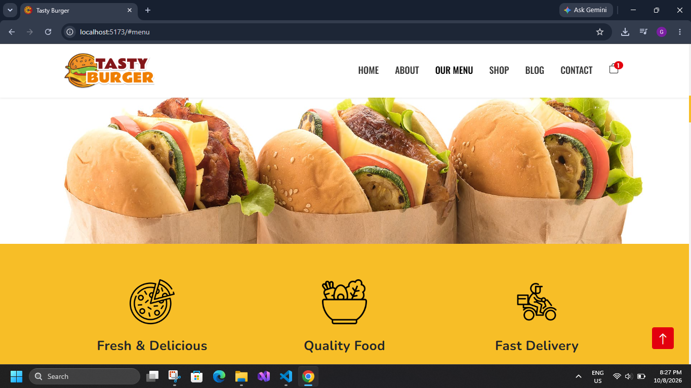
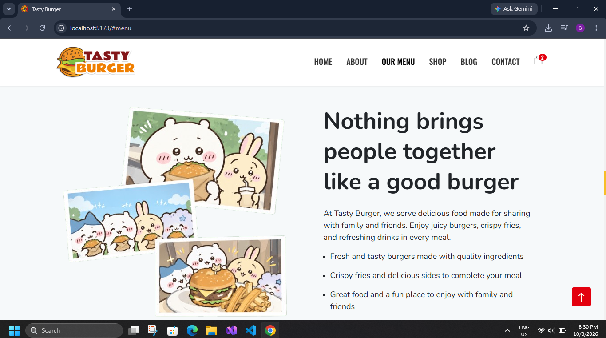
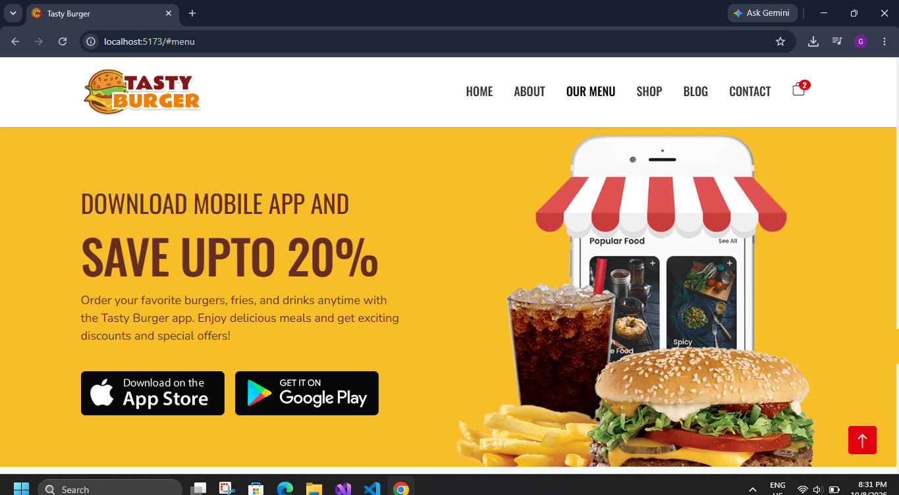
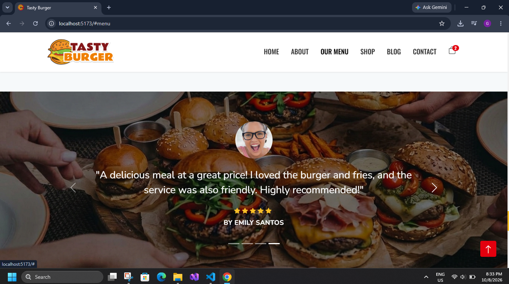
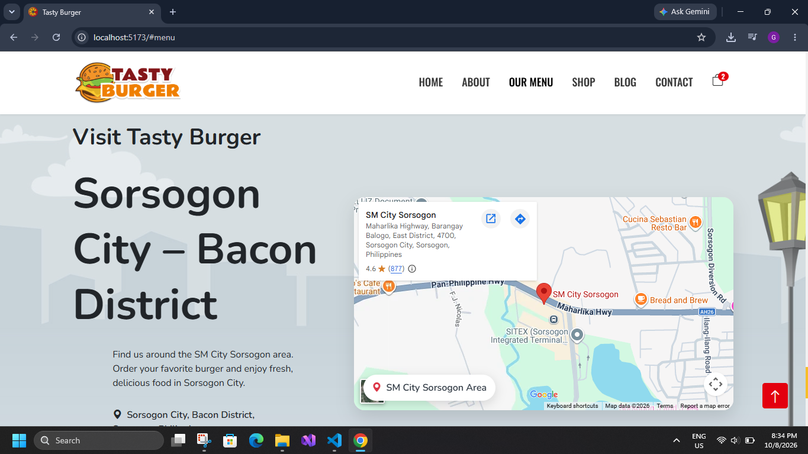
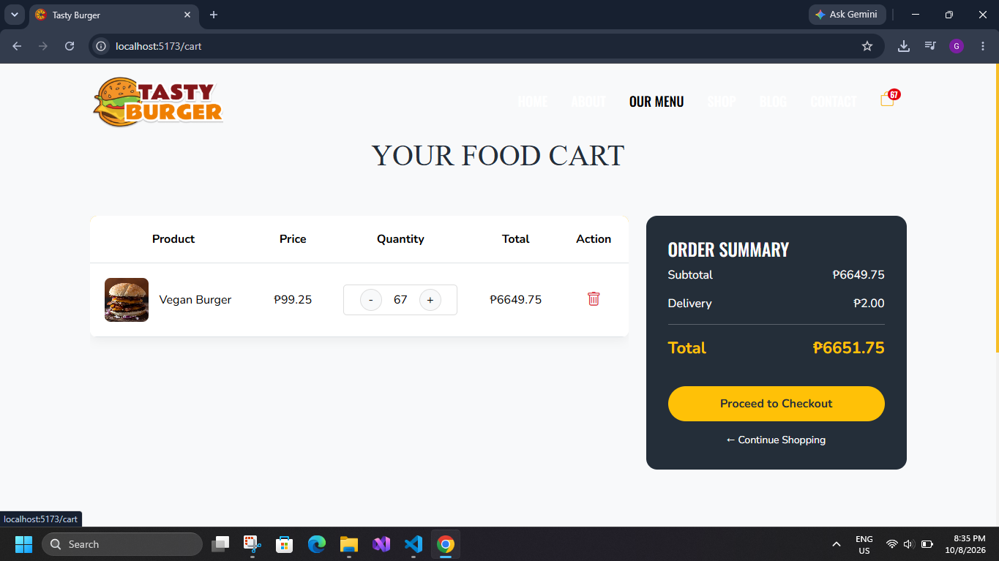
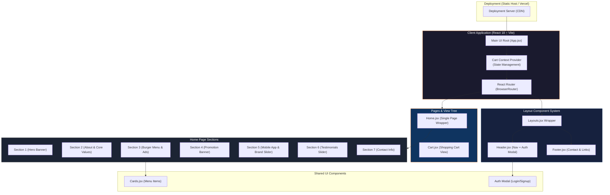
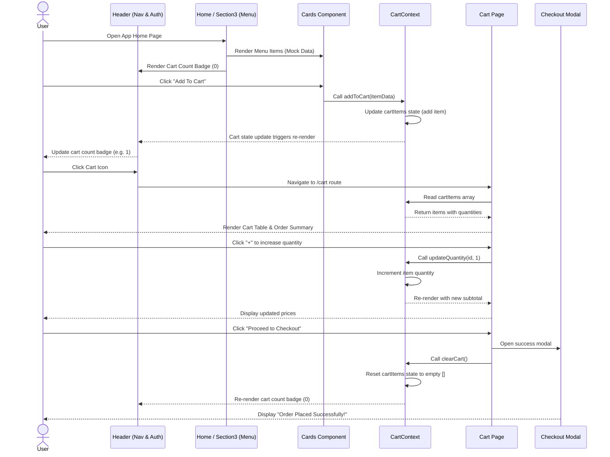

# 🍔 Tasty Burger · Premium Responsive Food Delivery Platform

---


---

## 📖 Executive Summary

**Tasty Burger** is a premium, high-performance food delivery single-page application (SPA) engineered on **React 18** and **Vite**. The application delivers a modern, mouth-watering user experience — connecting food lovers with seasonal promotions, gourmet menu categories, mobile app downloads, retail brand partners, and authentic customer testimonials through a polished, fully responsive interface.

Designed as a production-ready food delivery frontend showcase, the platform integrates a centralized **React Context API** state management system for shopping cart operations, a responsive card grid, brand and testimonial sliders, and a fully functional authentication modal. The catalog is powered by modular React components and mock data collections, enabling effortless transition from client-side simulation to live REST API backend integration — all wrapped in an appetizing, premium UI with mobile-first Bootstrap 5 layouts.

---

## 🖼️ Visual Tour

### Home & Hero Experience

<table>
  <tr>
    <td></td>
    <td></td>
  </tr>
</table>

The landing experience features a vibrant full-screen food delivery hero banner showcasing featured items, prices, and direct "Order Now" CTAs, alongside core brand trust badges highlighting food quality, original recipes, and superfast delivery.

---

### Interactive Menu & Promotions

<table>
  <tr>
    <td></td>
    <td></td>
  </tr>
</table>

The **Our Menu** section provides a responsive grid of menu cards displaying gourmet burgers with prices, customer ratings, and active "Add To Cart" buttons, followed by attractive promotional ad banners offering deals on select items.

---

### App Integration & Partners

<table>
  <tr>
    <td></td>
    <td></td>
  </tr>
</table>

The mobile integration section outlines download options with App Store and Google Play badges, followed by a sliding carousel highlighting retail partners, vendors, and ingredients suppliers.

---

### Client Testimonial & Social Proof

<table>
  <tr>
    <td></td>
    <td></td>
  </tr>
</table>

Customer reviews are displayed in an automated testimonial carousel containing ratings, text testimonies, and user avatars, backed by a comprehensive contact section with operational hours, maps, and store details.

---

### Authentication & Shopping Cart

<table>
  <tr>
    <td></td>
    <td></td>
  </tr>
</table>

A modular sign-in/register form modal provides client onboarding, while the dedicated `/cart` route manages item quantities, removes products, displays order subtotals with delivery fees, and processes checkout simulations.

---

## 🏗️ High-Level Architecture

The diagram below illustrates the end-to-end data flow and structure across the React client layout, state management providers, components, and pages.



---

## 📊 Low-Level Architecture

The sequence diagram below details the **Browse-to-Checkout** interaction flow — covering burger item selection, React Context state dispatching, cart modification, and order placement.



---

## ✨ Core Modules & Capabilities

### 1) Customer Ordering Experience (User-End)

- **Interactive Menu Hub:** A fully filterable list of gourmet products complete with descriptions, rating icons, prices, and wishlist indicators.
- **Dynamic Cart Management:** A centralized shopping cart that tracks multiple items, allows quantity increases/decreases, and calculates subtotal, delivery cost, and order total dynamically.
- **Mobile Integration Section:** Highlighting store application options with responsive design elements.
- **Seamless Interactive Sliders:** Brand slider and user reviews carousel using Bootstrap's built-in responsive Slider tools.
- **Header Navigation & Modal:** A sticky navbar that transitions background styles on page scrolling, complete with direct routing links and anchor points.

### 2) Security & Authentication Mockups

- **Glassmorphic Login Modal:** Centered dialog overlay with smooth registration/login switches.
- **On-the-fly Input Fields:** Integrated input forms for Name, Email, and Password values.

### 3) Codebase Architecture

- **React Context State:** Standard React `useContext` hook to manage the global cart state smoothly across detached components.
- **Bespoke UI Layouts:** Modular `Layouts.jsx` wrapping navbar and footer to keep application markup structured and DRY.
- **Bootstrap 5 UI framework:** Grid structures, icons, and components styled using standard CSS overlays.

---

## 🧳 Technology Stack

| Layer | Technology | Purpose |
| :--- | :--- | :--- |
| **Frontend Framework** | React 18, Vite | Ultrafast single-page app development with HMR and modular components. |
| **Styling & Icons** | Bootstrap 5, Bootstrap Icons | Responsive page styling, grid-based layouts, and standardized icons. |
| **State Management** | React Context API | Context-based global cart state tracking (Add, Remove, Quantity changes). |
| **Routing** | React Router DOM v6 | Seamless SPA navigation between landing layout and cart views. |
| **Build Tooling** | Vite, ESLint | Compilation, configuration, and code formatting rules. |

---

## 📂 Project Structure

```
Tasty-Burger/
├── assets/                          # Root assets for visual tour & store listings
├── public/                          # Public static items (logo, favicon)
├── src/
│   ├── components/                  # Reusable components
│   │   └── Layouts/
│   │       ├── Cards.jsx            # Burger card component
│   │       ├── Footer.jsx           # Footer links & contact
│   │       ├── Header.jsx           # Sticky nav & login modal
│   │       └── Layouts.jsx          # General page layout wrapper
│   ├── context/
│   │   └── CartContext.jsx          # Shopping cart global state provider
│   ├── pages/
│   │   ├── Home/                    # Home sections
│   │   │   ├── Home.jsx             # Main homepage aggregator
│   │   │   ├── Section1.jsx         # Hero banner
│   │   │   ├── Section2.jsx         # About us and features
│   │   │   ├── Section3.jsx         # Menu list & ads
│   │   │   ├── Section4.jsx         # Special promos banner
│   │   │   ├── Section5.jsx         # App download & brand slider
│   │   │   ├── Section6.jsx         # Testimonial reviews
│   │   │   └── Section7.jsx         # Contact information
│   │   └── Cart.jsx                 # Full checkout cart details page
│   ├── styles/                      # Customized CSS styles
│   │   ├── Home.css                 # Home sections layout styling
│   │   ├── cart.css                 # Checkout cart view styling
│   │   └── header.css               # Navbar & sticky style tweaks
│   ├── App.css                      # Global styling overrides
│   ├── App.jsx                      # App component shell & routes
│   └── main.jsx                     # Entry point structure
├── index.html                       # HTML base template
├── vite.config.js                   # Vite bundler rules
└── package.json                     # Main dependency lists
```

---

## 📌 Experience Highlights

- **Aesthetic Cinematic Dark/Orange Theme:** Designed around high-impact colors (deep reds, warm oranges, and dark text panels) to simulate standard premium food applications.
- **Contextual State Hooks:** Dynamic addition of items to the cart which immediately reflects in the header navbar badge.
- **Custom Rating Star Parser:** Renders precise filled, half-filled, and empty stars conditionally according to numerical values.
- **Completely Responsive Layouts:** Optimized for high-definition desktop monitors, tablets, and mobile views.

---

## 🖥️ Screens Overview

| Screen | Description |
| :--- | :--- |
| **Home Banner & Trust Badges** | Full-width main showcase featuring current specials and brand commitments (Fast Delivery, Organic Food). |
| **Gourmet Burger Menu** | Interactive grid of mock products detailing ratings, list prices, and direct "Add to Cart" triggers. |
| **Promos & App Download** | Deal grids and download sections targeting mobile user engagement. |
| **Customer Reviews Carousel** | Sliding testimonial block displaying guest names, scores, and text feedback. |
| **Authentication Form Modal** | High-contrast login/register popup overlay with validation placeholders. |
| **Order Cart Summary** | Table representation of selected foods displaying quantities, item delete, delivery fees, and order totals. |

---

## 📝 Feature Summary

- **Add to Cart Interaction:** Adding items updates header counts on the fly and appends details to `/cart`.
- **Cart Calculations:** Multiplies prices by item quantities, adds base delivery fees, and updates overall sums dynamically.
- **Interactive Checkouts:** Simulates order completions by clearing context values and rendering a success checkmark modal.
- **Sticky Header Scrolling:** Modifies header styling properties after scroll distances exceed 100px.

---

## 🔒 Notes & Security

- **Client-Side Simulation:** Authentication forms and checkout routines run completely on the client side, serving as a ready-to-plug template for REST API setups.
- **Local Data Imports:** Data is loaded from mock components, keeping site performance swift.
- **Production Optimized:** Ready for immediate deploy on services like Netlify, Vercel, or GitHub Pages.

---

## 📜 License & Rights
This repository and its contents are proprietary and intended for demonstration purposes only. Redistribution, copying, or using this codebase without explicit permission is not allowed.

All rights reserved. Developed by Muhammad Bilal (Full-Stack Software Architect).

---

<p align="center"><strong>Tasty Burger — Fresh Ingredients, Bold Flavors, Delivered Fast.</strong></p>

## React + TypeScript Setup
This updated version keeps the original Tasty Burger UI, CSS, images, navigation, favorites, cart, quantity controls, checkout modal, and sections. The source has been migrated from JSX to TypeScript (`.tsx`).

### Run in VS Code
```powershell
npm.cmd install
npm.cmd run dev
```

If you previously had the old dependency conflict, make sure the project uses Vite 7 and `@vitejs/plugin-react` 4 as shown in `package.json`. Do not copy an old `node_modules` folder into this project.
