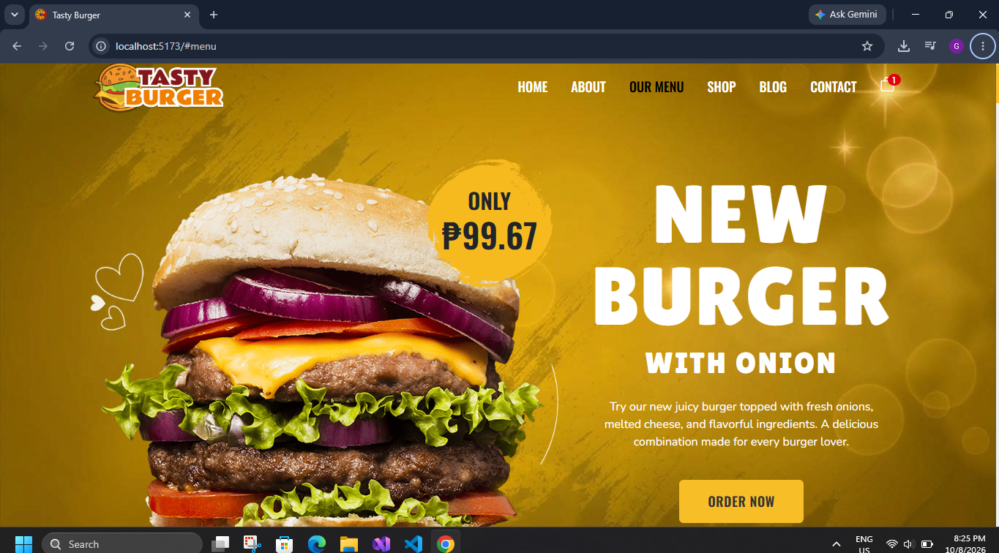
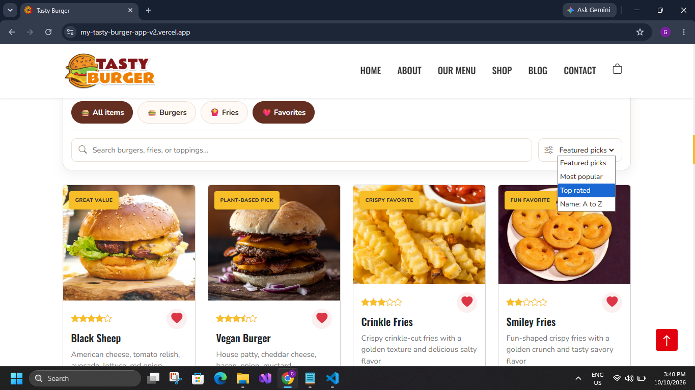
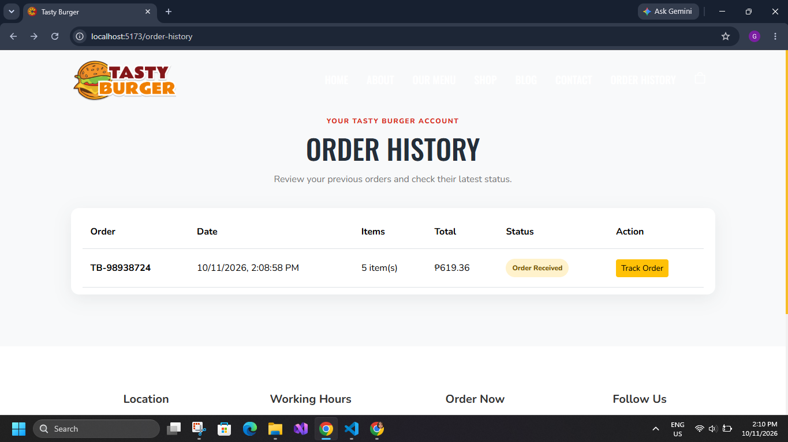
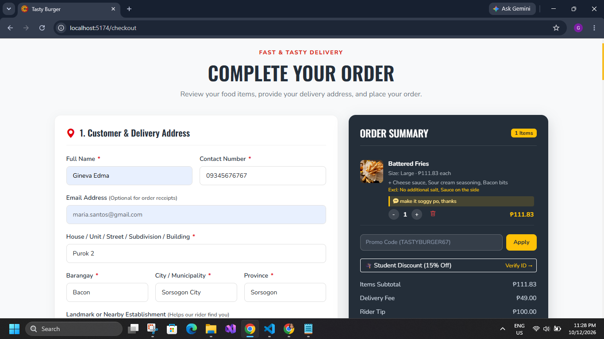

# 🍔 Tasty Burger

A simple burger ordering web app made with **React, TypeScript, and Vite**.

## ✨ Features

- 🍔 View different burger products
- 🛒 Add burgers to the cart
- ➕➖ Change item quantity
- ❤️ Add items to favorites
- 💰 View prices and order total
- 📦 Checkout order
- 📱 Responsive design
- 🔐 Login and register modal

## 🖼️ Screenshots

### 🏠 Home


### 🍔 Menu


### 🛒 Cart


### 🔐 Login


## 🛠️ Technologies

- ⚛️ React
- 📘 TypeScript
- ⚡ Vite
- 🎨 CSS
- 🛒 React Context

## 🚀 How to Run

Open the project in VS Code, then run:

```bash
npm install
npm run dev
```

Open the local link shown in the terminal.

## 📁 Main Folders

```text
src/
├── components/  # reusable components
├── pages/       # app pages
├── context/     # cart state
├── assets/      # images
└── App.tsx      # main app
```

## 👨‍💻 Project

Made as a student web app project. 🍔✨

**Tasty Burger — Fresh burgers, easy ordering!** 🍟🥤
